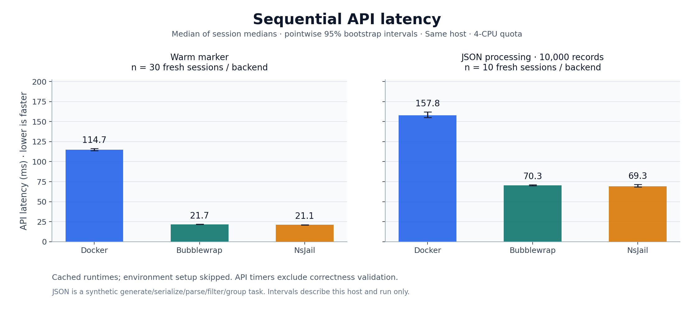
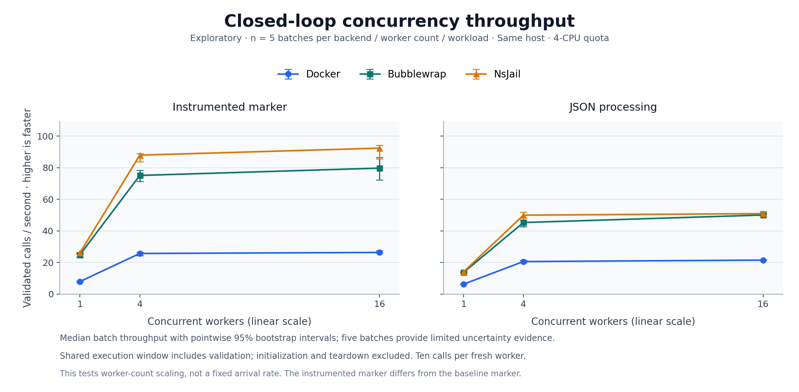

# Expanded backend performance experiments

Measured 2026-10-16 14:30–15:02 Asia/Saigon on `main` at `d79a0e2038ba90f267a3f5109beea9810dde292a`. Micromamba is excluded. This is a new controlled experiment; the original ten-session results remain unchanged in the parent folder.

## Minimal-call latency and startup

The primary estimate is the **median of the 30 session medians**, with a pointwise 95% bootstrap interval in brackets. Each session contains ten measured warm calls. Times are milliseconds. Startup uses cached images/imports and excludes environment setup.

| Backend | Session open, ms [95% CI] | Warm run, ms [95% CI] | Warm pooled p95, ms | Close, ms |
| --- | ---: | ---: | ---: | ---: |
| Bubblewrap | 10.64 [10.22, 10.94] | 21.65 [21.55, 21.83] | 24.01 | 1.15 |
| NsJail | 9.65 [9.46, 9.91] | 21.14 [20.71, 21.31] | 24.12 | 1.14 |
| Docker | 2,582.48 [2,535.31, 2,613.05] | 114.73 [113.82, 116.46] | 128.47 | 10,178.27 |

The same 30 baseline sessions also measure a 200,000-iteration arithmetic loop and ten 1 MiB transfer pairs per session. These API timings use the same session-level estimate and intervals. Filesystem caches are warm.

| Backend | CPU-loop API, ms [95% CI] | Upload 1 MiB, ms [95% CI] | Download 1 MiB, ms [95% CI] |
| --- | ---: | ---: | ---: |
| Bubblewrap | 61.02 [60.72, 61.96] | 0.87 [0.83, 0.89] | 0.97 [0.92, 1.05] |
| NsJail | 60.93 [60.21, 61.35] | 0.88 [0.85, 0.90] | 0.98 [0.91, 1.04] |
| Docker | 154.17 [152.48, 155.92] | 54.79 [53.85, 55.77] | 5.64 [5.56, 6.00] |

The paired Bubblewrap/NsJail warm-latency ratio is 1.024 [1.015, 1.046] across 30 matched randomized rounds. A ratio above 1 means Bubblewrap took longer. NsJail has lower minimal-call latency within this run; the result remains specific to this host and configuration.

Docker's default process still makes teardown a separate lifecycle cost. This experiment preserves its default stop behavior; pooling and alternative init/stop policies were not tested.

## Offline environment setup

Ten fresh sessions per backend, with a new virtual environment each time. This is **offline setup-inclusive startup**, not a package-download benchmark. Docker's regular pip-upgrade command runs with `PIP_NO_INDEX=1`; native setup is offline by default. All runtimes begin from the same CPython build and bundled pip. Times are milliseconds.

| Backend | Setup-inclusive open [95% CI] | First run [95% CI] | Close |
| --- | ---: | ---: | ---: |
| Bubblewrap | 2,557.78 [2,549.53, 2,571.75] | 22.62 [21.61, 22.83] | 9.53 |
| NsJail | 2,566.95 [2,532.89, 2,583.95] | 21.02 [20.21, 22.25] | 9.71 |
| Docker | 5,882.48 [5,749.13, 6,046.63] | 113.67 [105.76, 120.32] | 10,186.50 |

## Broader workload and larger transfers

Ten fresh sessions per backend, ten JSON operations and three 16 MiB upload/download pairs per session. The synthetic workload generates, serializes, parses, filters and groups 10,000 deterministic order records. An independent arithmetic oracle validates the result. Upload and download contents are independently SHA-256 checked.

| Backend | JSON API latency, ms [95% CI] | Upload 16 MiB, ms [95% CI] | Download 16 MiB, ms [95% CI] | Payload CPU, ms | Payload peak RSS, MiB |
| --- | ---: | ---: | ---: | ---: | ---: |
| Bubblewrap | 70.32 [69.86, 71.02] | 6.72 [6.33, 7.12] | 5.93 [5.66, 6.27] | 28.13 | 17.62 |
| NsJail | 69.28 [68.50, 71.55] | 6.93 [6.72, 7.19] | 6.09 [5.80, 6.45] | 28.41 | 17.63 |
| Docker | 157.80 [155.00, 162.08] | 78.35 [75.41, 115.76] | 43.96 [41.40, 63.92] | 28.65 | 18.50 |

CPU values are process CPU-time deltas around the payload work. Peak RSS is the Python process high-water mark, including its interpreter. These figures exclude daemon, launcher and controller resource use; they do not measure total sandbox memory or backend efficiency.

## Concurrent throughput

Closed-loop load: each worker owns a fresh session and makes ten sequential calls. Every worker completes setup and warmup before the shared timer starts; none begins teardown until all execution finishes. Throughput includes validation and caller bookkeeping in the shared execution window. Initialization and teardown are separate in the raw/CSV results. Concurrent latency uses instrumented payloads, so its marker is not identical to the baseline's simple print.

Each cell is the median **validated calls/second [95% CI] across five independent batches**. These small-sample intervals are exploratory. Failures invalidate a batch's performance summaries and remain visible in the evidence.

### Instrumented minimal payload

| Backend | 1 worker | 4 workers | 16 workers |
| --- | ---: | ---: | ---: |
| Bubblewrap | 24.84 [23.35, 25.68] | 75.09 [71.28, 78.41] | 79.73 [72.31, 86.44] |
| NsJail | 26.06 [25.26, 26.25] | 87.94 [83.80, 89.00] | 92.38 [85.64, 94.17] |
| Docker | 7.88 [7.67, 8.24] | 25.66 [24.26, 26.39] | 26.32 [25.82, 27.40] |

### 10,000-record JSON workload

| Backend | 1 worker | 4 workers | 16 workers |
| --- | ---: | ---: | ---: |
| Bubblewrap | 13.61 [13.12, 13.78] | 45.26 [42.52, 46.77] | 50.02 [49.25, 51.17] |
| NsJail | 14.02 [13.79, 14.42] | 49.93 [46.86, 51.84] | 50.91 [50.34, 52.40] |
| Docker | 6.22 [6.12, 6.47] | 20.55 [19.83, 21.41] | 21.47 [21.29, 21.86] |

JSON throughput increases by approximately 2–11% when moving from four to sixteen workers across these backends (point estimates). The host has a four-CPU cgroup quota with five CPUs visible, so 16 workers oversubscribe available CPU. Both load generation and runtimes share this host. The tested maximum is not a proven saturation point or production capacity, and client concurrency is not a controlled offered-arrival-rate experiment.

## Validation, controls and limits

| Profile | Passed / attempted independent units | Unit |
| --- | ---: | --- |
| baseline | 90 / 90 | session |
| setup | 30 / 30 | session |
| workload | 30 / 30 | session |
| concurrency | 90 / 90 | batch |

Concurrency additionally completed 630 / 630 worker sessions and 6,300 validated measured calls. Every profile excludes its preflight/warmups. Failed calls are never represented as zero latency, and whole failed sessions/batches are excluded from estimates. Docker removal is independently confirmed after close.

- Each of 30 baseline rounds contains every runnable backend exactly once in seed-randomized order. Setup/workload rounds and backend/load/workload combinations are randomized separately. Seeds and complete planned/executed orders are preserved.
- Confidence intervals use 10,000 percentile-bootstrap resamples of complete session medians or complete batch medians. Paired backend ratios resample matched rounds together. Individual correlated calls are not treated as independent replications. Pooled p95 is descriptive without a confidence interval; this is not a p99/SLO certification.
- All three backends use the same official CPython 3.13.5 binary/build and standard library. Native backends receive its extracted prefix read-only. Host and container OS shared libraries still differ. This change improves comparability but means movement from the original report is not a software-regression estimate.
- Docker 28.4.0 uses VFS storage. Native default namespace/seccomp isolation is retained, and network is disabled throughout measured work. The native artifact ceiling is 32 MiB for the larger transfer. Different backends do not provide identical security boundaries.
- Hardware: Linux x86-64 / AMD EPYC 7763, four-CPU quota and 16 GiB memory limit. Image downloads, provisioning, compilation, unit tests and statistical bootstrap computation happened outside the authoritative measurements.
- Intervals are pointwise, conditional on this host/configuration/time period, and not adjusted for multiple comparisons. Sessions share one host and may retain temporal correlation despite randomized order. No independent host replication, cold-image downloads, online package updates or production trace replay was performed.
- Podman and Kubernetes remain unavailable for the previously verified host limitations (`devpts` and `/dev/kmsg`). Windows MXC and WSL2 Bubblewrap need a Windows host. Those results are not estimated or pooled with the measured backends.

## Reproduce and inspect

- [Expanded runner instructions](../../README.md) and [run script](../../run_expanded.sh).
- [Preparation and setup controls](PREPARATION.md), [runtime image/binary identity](runtime-identity.json), [host limits](host.json).
- Raw data: [baseline](baseline.json), [offline setup](setup.json), [JSON/transfers](workload.json), [concurrency](concurrency.json).
- [Statistical summaries and paired comparisons](summary.json) and [flat CSV](summary.csv).
- [Raw-data audit](raw-audit.json), [audit script](audit_raw.py), and [independent statistics audit](statistics-audit.md) with its [script](audit_statistics.py).
- Editable figures: [latency SVG](latency-comparison.svg), [throughput SVG](concurrency-throughput.svg), [plotting script](plot_results.py), and [plotting environment](plotting-environment.txt).
- [Original availability diagnostics](../provisioning-diagnostics.json) and [initial report](../REPORT.md).
- Frozen Python source snapshots are in `source/`. Runner metadata hashes the measured harness/workload sources; [the final SHA-256 manifest](sha256-manifest.json) also covers the statistics code, configurations and evidence files.

Validation before the authoritative run: 96 focused tests passed, Ruff lint/format passed, and real workload/concurrency smoke checks passed. The independent raw-data audit passed 68,768 checks with zero errors, covering 780 measured sessions and 12,990 validated API samples including lifecycle calls. The separate statistics audit passed 7,410 checks with zero findings and independently reproduced six selected 10,000-resample confidence intervals. No Docker containers remained after completion.
